<div align="center">

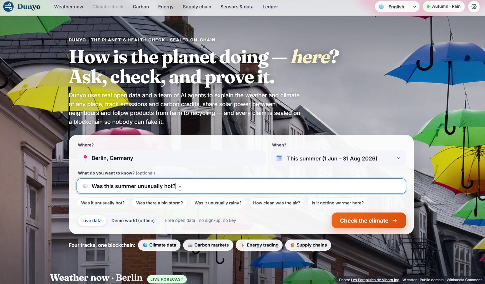

# 🌍 Dunyo

### The planet's health check, sealed on the blockchain.

Real open data · AI that doubts itself · one shared blockchain for climate data, carbon credits, energy trading and product passports.

[](#-quick-start)
[](#-tests)
[](#-four-tracks-one-blockchain)
[](#-built-for-everyone)
[](#-open-data)
[](LICENSE)

**[▶ Watch the demo](https://youtu.be/bpdqqK_auOA)** · **[📄 Technical report](report/DunyoTechnicalReport.pdf)** · **[🚀 Run it in 2 minutes](#-quick-start)**

*IEEE ClimateChain Global Hackathon 2026 · primary track: Climate Data & Environmental Monitoring, with working desks for all four tracks*

</div>

## 💡 The idea

Climate action runs on **claims**: *“this summer was exceptional”*, *“our plant emitted 20,000 t”*, *“these credits are real”*,
*“this street runs on solar”*, *“this product is low carbon”*, *“this sensor says the air is clean”*.
The data behind them is scattered, hard to read and easy to fake or count twice.

**Dunyo checks each claim against real open data with AI, explains the answer in plain words for anyone, and seals every input
and result on ClimateChain**, a ledger with real Ed25519 signatures, Merkle roots and smart contract rules that block double counting.

> **AI and physics check whether a claim is true. The blockchain guarantees it is unique, final and tamper evident.**

## 🎬 Demo

<div align="center">

[](https://youtu.be/bpdqqK_auOA)

**▶ [Watch the 4 minute narrated demo on YouTube](https://youtu.be/bpdqqK_auOA)**
<br>Recorded live for Berlin (English), Istanbul (Türkçe) and Tehran (فارسی)

</div>

## 🔎 Ask in plain words, get a straight answer

Pick any place and ask *“Was this summer unusually hot?”* Nine AI agents gather 35 years of records from two independent
sources, find the unusual days, check satellites and the news, and a critic agent tries to prove them wrong.

<table>
<tr>
<td width="50%">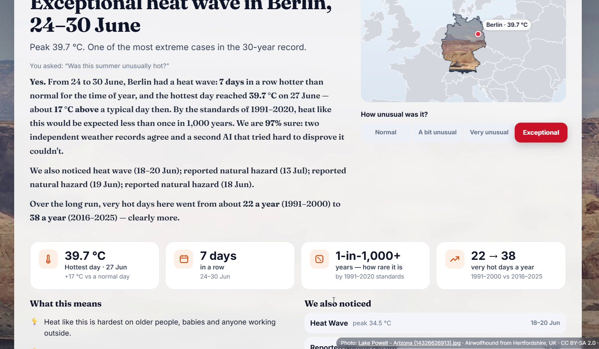<br><sub><b>The answer.</b> Berlin, summer 2026: an exceptional heat wave from 24 to 30 June, peaking at 39.7 °C, rarer than once in 1,000 years by 1991 to 2020 standards, with 97 % confidence.</sub></td>
<td width="50%">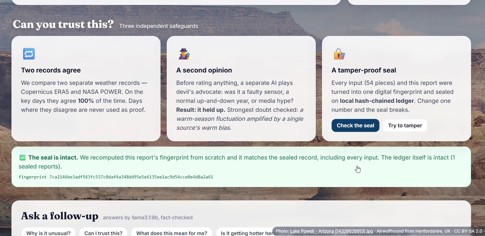<br><sub><b>Can you trust it?</b> Two records (ERA5 and NASA POWER) must agree, a second AI tries to refute the result, and every input is sealed. Change one number and the seal breaks.</sub></td>
</tr>
<tr>
<td width="50%">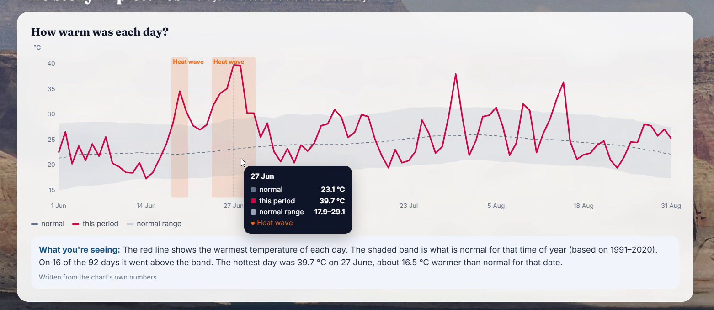<br><sub><b>Every chart explained</b> in one sentence anyone can read, optionally polished by a local LLM, with every number fact checked.</sub></td>
<td width="50%">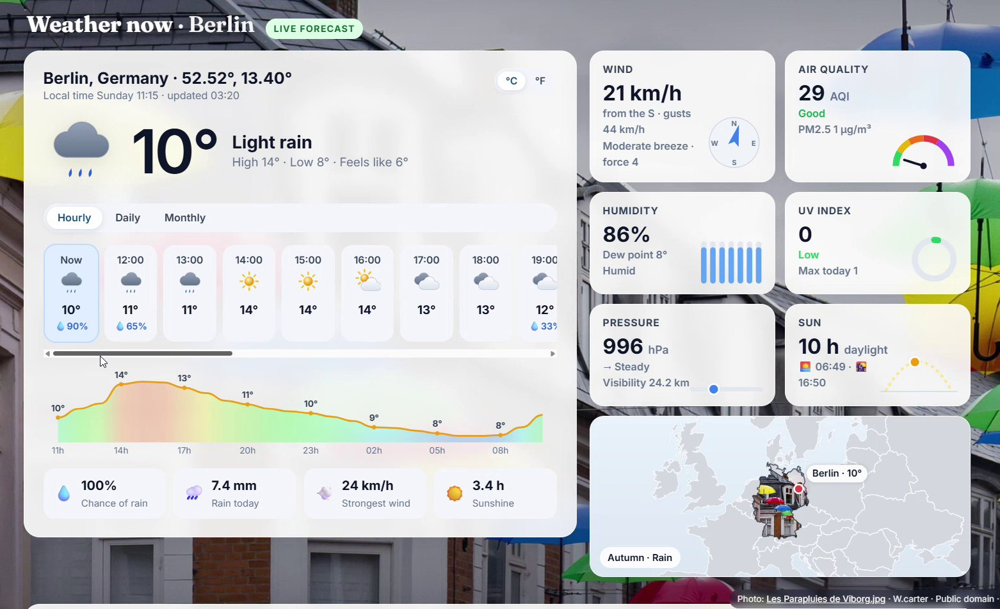<br><sub><b>Weather now</b> for the exact spot: hourly, daily and monthly outlook, air quality, UV, wind, sun and a map, behind a real photo of today’s season and weather.</sub></td>
</tr>
</table>

## 🧩 Four tracks, one blockchain

<div align="center">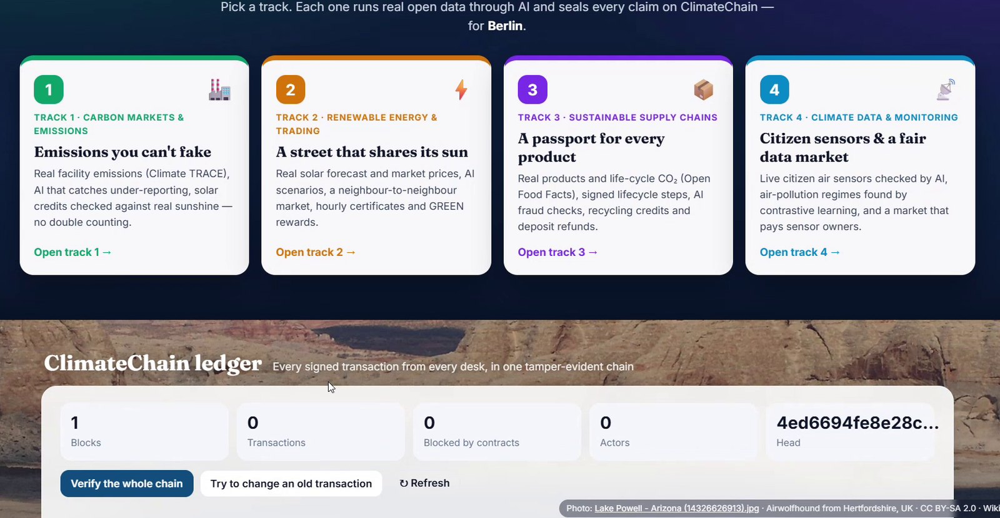</div>

| | Track | What happens (real data) | AI inside | 🕵️ “Try to cheat” is stopped |
|:-:|:-|:-|:-|:-|
| 🏭 | **1 · Carbon markets & emissions** | A real facility from **Climate TRACE**; its sensor stream hides two days of under reported fuel. A solar farm’s credit claim is checked against **real sunshine**. | self supervised masked model · **MCMC** · Monte Carlo solar physics | issue twice · credit in a second registry · retire twice · sell retired credits |
| ⚡ | **2 · Renewable energy & trading** | A solar street plans tomorrow with the **real forecast** and **real day ahead prices**; neighbours trade hour by hour; every kWh becomes an **hourly certificate**. | **Markov chain Monte Carlo** (300 cloud scenarios) · load shifting | noon certificate used at 8 pm · mint twice · 12 kWh from a 5 kW roof |
| 📦 | **3 · Sustainable supply chains** | Any barcode becomes a **digital product passport** with real **Open Food Facts** data and Agribalyse life cycle CO₂; deposit refund and recycling credits, once. | Markov chain of lifecycle paths · shipment physics · signed label claims | double refund · wrong signer · skipped steps · 3,000 km by truck in 2 h |
| 📡 | **4 · Climate data & monitoring** | Live **citizen air sensors** are cross checked; a research lab buys the verified data and trusted sensor owners are paid 80 %. | spatial masking + Bayesian trust · **contrastive learning (InfoNCE)** | replayed sensor batch · impostor key |

<table>
<tr>
<td width="50%">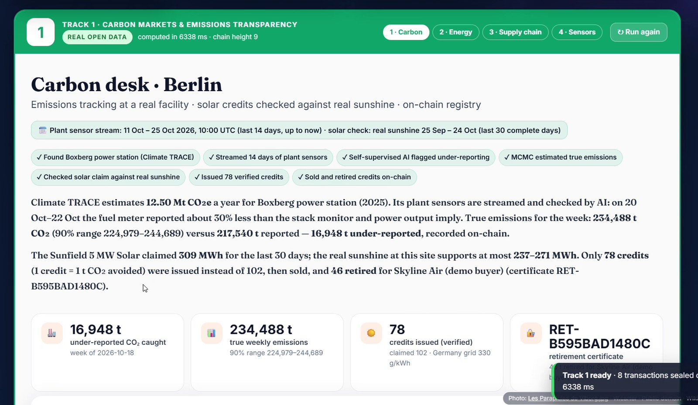<br><sub><b>Track 1.</b> Boxberg power station: 16,948 t of under reported CO₂ caught; 102 claimed solar credits cut to 78 verified.</sub></td>
<td width="50%">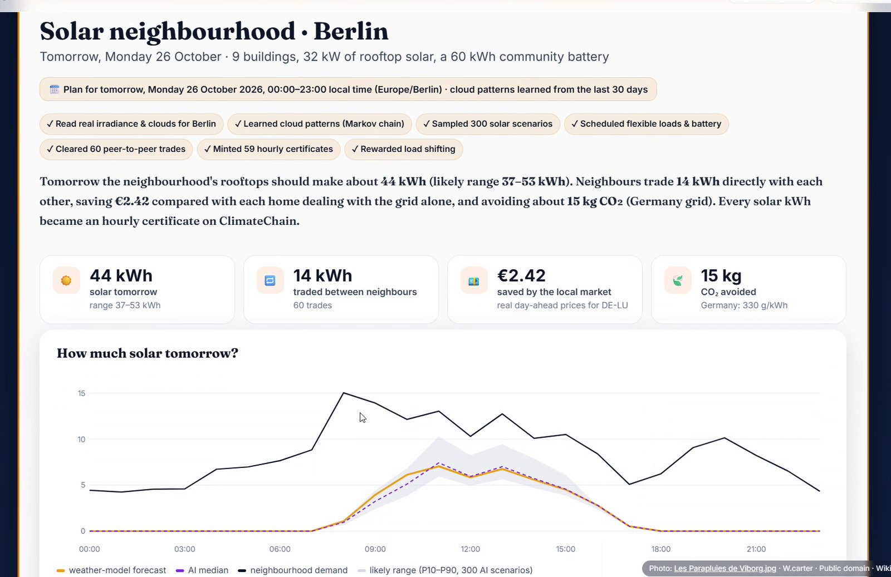<br><sub><b>Track 2.</b> 44 kWh expected tomorrow (range 37 to 53), 14 kWh traded between neighbours, €2.42 saved.</sub></td>
</tr>
<tr>
<td width="50%">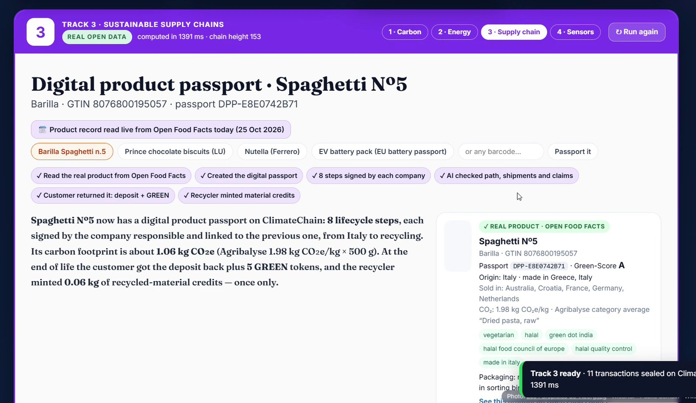<br><sub><b>Track 3.</b> A real Barilla Spaghetti Nº5 passport: 8 signed steps, 1.06 kg CO₂e, recycled once.</sub></td>
<td width="50%">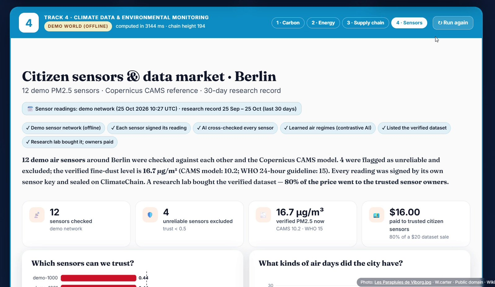<br><sub><b>Track 4.</b> 12 sensors checked, 4 excluded, verified PM2.5 of 16.7 µg/m³; air pollution regimes found without labels.</sub></td>
</tr>
</table>

## ⛓️ ClimateChain

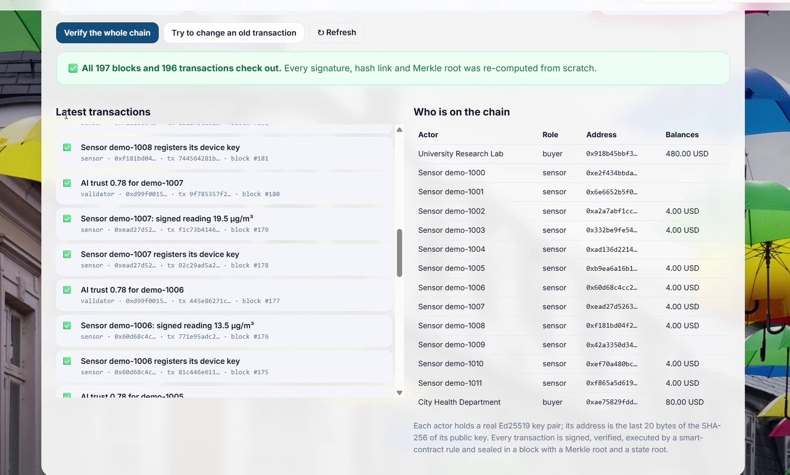

**Signed transactions.** Every actor (registry, verifier, solar farm, prosumer, factory, recycler, citizen sensor, AI validator) owns an **Ed25519** key; its address is the last 20 bytes of SHA256 of the public key.

**Smart contract rules.** Carbon registry, energy market, product passport, data market and evidence registry. Rejected transactions stay on the chain **as evidence**.

**Blocks.** Each block holds the previous hash, the **Merkle root** of its transactions and a **state root**.

**Verify and tamper test.** One click re-checks every signature, link and root from scratch; change one old number and verification fails.

**Solidity** versions of all five contracts are in `contracts/` for any EVM chain; climate reports can also be anchored on Sepolia.

<br clear="right">

## 🧠 AI that doubts itself

| Method | Where | Why |
|:-|:-|:-|
| Self supervised masked feature reconstruction | Track 1, climate check | learns how signals move together from unlabeled data; residuals flag tampering |
| Spatial masking + Beta reputation | Track 4 | predicts each hidden sensor from its neighbours; trust drives revenue |
| Contrastive learning (SimCLR style InfoNCE) | Track 4 | label free embedding of 24 hour windows into pollution regimes |
| Metropolis Hastings MCMC | Track 1 | true emissions with a 90 % interval from three imperfect meters |
| Markov chains + Monte Carlo sampling | Tracks 2 and 3, climate check | forecast ranges, plausibility of lifecycle paths, regime surprise |
| Extreme value statistics · BLUE fusion · Bayes vs Γ minimax | climate check | return periods, optimal source fusion, robust decisions |
| 9 ReAct agents + critic + judge | climate check | plan tools by value of information, try to refute, decide |
| Local LLM (Ollama, optional), **fact checked** | explanations, chat | friendlier words; every number must appear in the data |

<div align="center">
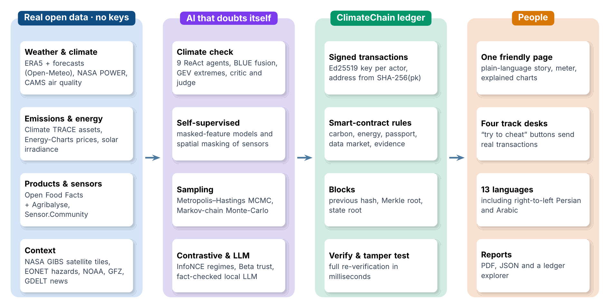
<br>
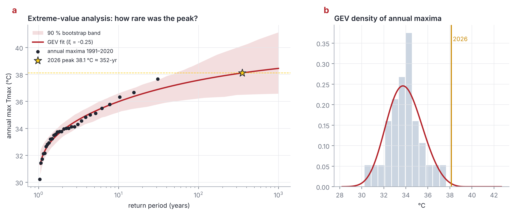 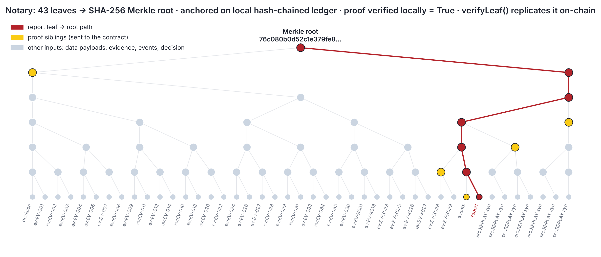
<br><sub>For the experts (“Under the hood” in the app and in every PDF report): extreme value analysis of the peak, and the Merkle proof of an investigation.</sub>
</div>

## 🌐 Built for everyone

<table>
<tr>
<td width="50%">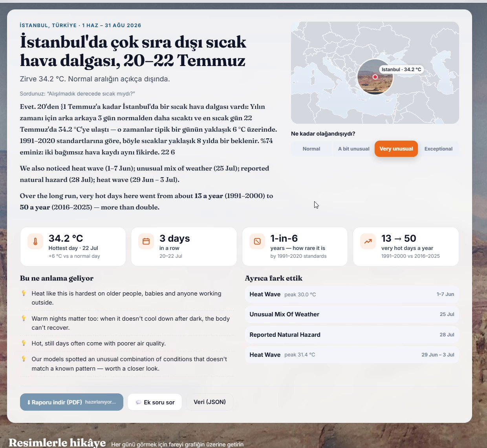<br><sub>İstanbul, in Türkçe</sub></td>
<td width="50%">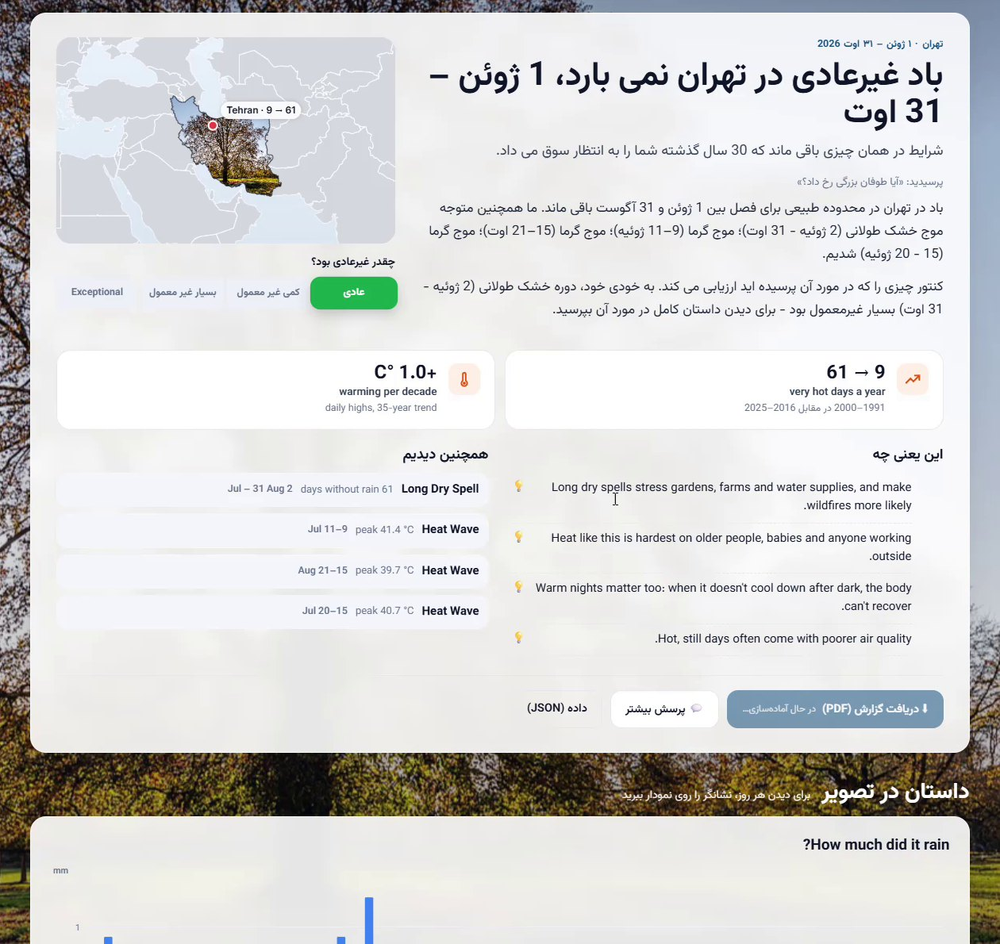<br><sub>Tehran, in فارسی (right to left)</sub></td>
</tr>
</table>

**13 languages:** English, Türkçe, فارسی, हिन्दी, 中文, Français, Español, العربية, Русский, Deutsch, Português, 日本語, Oʻzbekcha.
Labels are human translated; generated text is translated by the browser’s on device translator or the local LLM, and a translation that changes a number is rejected.

**Any place, any period up to today,** half hour time zones included; the newest days come from the latest model analyses, bias matched to ERA5.

**Never a broken demo:** every connector has a timeout, cache and circuit breaker, and each desk shows which data connections worked.

## 🚀 Quick start

Needs **Python 3.10 to 3.12**. No accounts, no API keys.

```bash
git clone https://github.com/soroorgh93/dunyo.git
cd dunyo
pip install -r requirements.txt
python -m dunyo photos     # once: real weather photos (credited) and world map
python -m dunyo app        # opens http://127.0.0.1:8765
```

Windows: double click **`Dunyo.bat`** · macOS and Linux: `./dunyo.sh` (both create a virtual environment on first run).

**Optional:** for friendlier explanations, follow up chat and live translation with a free local AI, install [Ollama](https://ollama.com),
run `ollama pull llama3.2` and restart Dunyo. It is detected automatically.

**Try these:** Berlin · *This summer* · “Was it unusually hot?”, then open each track and press the 🕵️ cheat buttons ·
Istanbul in Türkçe · Tehran in فارسی · any barcode in Track 3 (for example `3017620429484`).

<details>
<summary><b>Command line, settings and public chain</b></summary>

```bash
python -m dunyo investigate --place "Istanbul" --start 2026-07-01 --end 2026-08-31
python -m dunyo investigate --place Istanbul --replay       # offline synthetic world
python -m dunyo verify runs/<run_id>/report.json            # recompute the hash, check the ledger record
python -m dunyo selftest                                    # check every data connector
```

Copy `.env.example` to `.env` to set a cloud LLM (Groq, Gemini, OpenAI) or a Sepolia RPC URL with a **test wallet** key
(`python -m dunyo deploy-contract`). Never commit `.env`.
</details>

## 🧪 Tests

```bash
python -m pytest -q          # or: python tests/run_tests.py
```

25 tests cover Merkle proofs, signatures and tamper detection, every double counting rule, all four desks offline, half hour
time zones, bias matching of the newest days, closed form Bayes and minimax results, and translation table completeness.

## 📡 Open data

| Source | Used for | Licence |
|:-|:-|:-|
| [Copernicus ERA5](https://cds.climate.copernicus.eu) and forecasts via [Open-Meteo](https://open-meteo.com) | weather since 1940, forecasts, seasonal outlook | CC BY 4.0 |
| [NASA POWER](https://power.larc.nasa.gov) | independent second weather record | open |
| Copernicus CAMS via Open-Meteo | air quality (PM2.5, PM10, NO₂, O₃) | CC BY 4.0 |
| [Climate TRACE](https://climatetrace.org) | asset level emissions | CC BY 4.0 |
| [Energy-Charts](https://api.energy-charts.info) (Fraunhofer ISE) | day ahead electricity prices | CC BY 4.0 |
| [Open Food Facts](https://world.openfoodfacts.org) + ADEME Agribalyse | products, packaging, life cycle CO₂ | ODbL |
| [Sensor.Community](https://sensor.community) | live citizen PM sensors | ODbL |
| NASA GIBS and EONET, NOAA CPC, GFZ, GDELT | satellite tiles, hazards, ENSO, Kp, news context | open |
| Wikimedia Commons · Natural Earth | background photos (credited on screen) · map outlines | CC / PD |

## 🛡️ Responsible by design

Uncertainty is always shown. News and social text is untrusted context only: aggregated, stripped of personal data and guarded
against prompt injection. No personal data is stored. Corrections are never silent: a corrected result is a new sealed report
that references the old hash.

## 🗂️ Project structure

```
dunyo/
  agents/      9 agent investigation (ReAct planner, critic, Bayes and minimax judge, safety, LLM)
  tracks/      the four desks: carbon, energy, supply, sensors, plus the AI models and live data connectors
  chain/       ClimateChain: signed transactions, contract rules, blocks, Merkle proofs
  data/        weather and climate connectors, fusion, weather now
  events/      phenomenon detectors, evidence graph
  mathcore/    Bayes, decision theory, extremes, Markov, surprise
  models/      classical and optional deep anomaly models
  memory/      cache, hierarchical memory, GraphRAG
  server.py    local web server (standard library + server sent events)
ui/            the web page (HTML, CSS, JS, 13 languages)
contracts/     Solidity versions of the five contracts
knowledge/     cited knowledge base used by the agents
report/        technical report (PDF)
tests/         unit and end to end tests
```

## 📚 References

IPCC 2006 Guidelines (emission factors) · ICVCM Core Carbon Principles (double counting) · EnergyTag Granular Certificate
Scheme (hourly matching) · Regulation (EU) 2023/1542 (battery passport, recycled content) · Regulation (EU) 2024/1781
(Digital Product Passport) · UK DESNZ 2025 GHG conversion factors (freight per tonne km) · Ember Global Electricity Review
2025/2026 (grid carbon intensity) · IEA Global EV Outlook (battery footprint) · WHO Global Air Quality Guidelines 2021 ·
Hersbach et al. 2020 (ERA5) · Chen et al. 2020 (SimCLR) · Jøsang & Ismail 2002 (Beta reputation) · Coles 2001 (extreme
values) · Yao et al. 2023 (ReAct) · Lehmann & Casella 1998 (decision theory). Full details in the
[technical report](report/DunyoTechnicalReport.pdf).

## 📄 License

MIT © 2026 Soroor Ghandali. Background photographs: Wikimedia Commons contributors (free licences, credited in the app).
